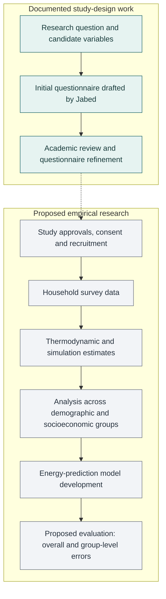

# Fair AI for Household Energy Prediction

**Designing the data needed to investigate unequal errors in household energy predictions.**

**Jabed Hossain** · Research collaboration with UWE Bristol academics  
**Stage:** research design and questionnaire development

I drafted the initial study questionnaire, connecting demographic and socioeconomic characteristics with housing and everyday energy-use behaviour. Academic leads refined and finalised the questionnaire. This repository presents that contribution, the study rationale and the proposed path towards model evaluation.

[Research summary (PDF)](docs/research-summary.pdf) · [Read the questionnaire](questionnaire/household-energy-questionnaire.md) · [Contribution & status](docs/contribution-and-status.md) · [References](references/reading-list.md) · [Original research materials](research-materials/README.md)

## The question

**Could an energy-prediction model perform well overall while making systematically different errors for different households?**

Households with the same number of occupants can have different working patterns, heating needs, cooking routines and housing conditions. Those differences may also vary across demographic and socioeconomic groups. The study asks what information is needed to investigate those relationships and their implications for prediction fairness.

The practical challenge begins with measurement: define the variables and collect the evidence needed to test a claim about fairness.

## My contribution

- **Drafted the initial questionnaire:** organised household, socioeconomic, housing and behavioural questions into a usable study instrument.
- **Connected variables to the research question:** included information that could support investigation of group differences alongside the physical and behavioural drivers of energy use.
- **Worked through academic refinement:** the materials include an initial draft and expanded revisions covering occupancy schedules, building fabric, heating controls and energy practices. Academic leads refined and finalised the instrument.

The [contribution record](docs/contribution-and-status.md) distinguishes my work, the academic contribution and the planned empirical stages.

## Research workflow

The solid section describes documented study-design work. The dashed transition leads into proposed empirical work; the evaluation details are developed in the [proposed evaluation plan](docs/evaluation-plan.md).



## What the questionnaire captures

| Domain | Examples in the revised draft | Research purpose |
|---|---|---|
| Household and demographics | Household composition, age, gender, disability, ethnicity and other demographic characteristics | Define potential groups for investigating differences |
| Socioeconomic circumstances | Education, income bands, employment, working patterns, tenure and residential setting | Understand household circumstances and constraints |
| Housing and systems | Floor area, building age, rooms, insulation, glazing, heating, hot water and ventilation | Account for physical drivers of energy demand |
| Occupancy and behaviour | Weekday/weekend presence, cooking, visitors, lighting, laundry and hot-water use | Describe how homes are occupied and used |
| Lifestyles and energy practices | Temperature preferences, cooling, window opening, efficient-appliance indicators, cooking fuel and attitudes | Capture practices that may be missed by limited household descriptions |

See the [variable map](questionnaire/variable-map.md) for the question-to-domain mapping and the [questionnaire](questionnaire/household-energy-questionnaire.md) for the actual draft questions and response options.

## Evidence and current scope

| Component | What this repository provides |
|---|---|
| Study design | A project overview derived from the academic outline |
| Questionnaire | A clean transcription of the revised draft, with research notes separated from respondent questions |
| Personal contribution | Initial questionnaire drafting, with academic refinement attributed |
| Literature | A linked bibliography and all 16 original papers from the project reading folder |
| Evaluation | A proposed protocol for future prediction-error and group-level analysis |
| Empirical results | No completed survey, trained model or measured fairness improvement is reported here |

The outline proposes recruiting **2,000 UK participants**. This is a planning target. The supplied materials do not establish a recruited sample or completed data collection.

## What would make the next stage convincing?

The proposed evaluation should measure overall error and errors within adequately represented groups, keep preprocessing inside training folds, and test the value of additional questionnaire domains through ablations. It should also distinguish estimates generated by simulation from measured energy consumption. These are proposed next steps, documented in the [evaluation plan](docs/evaluation-plan.md).

## Explore the repository

```text
.
├── README.md
├── docs/
│   ├── research-summary.pdf
│   ├── research-design.md
│   ├── contribution-and-status.md
│   ├── evaluation-plan.md
│   └── figures/research-workflow.mmd
├── questionnaire/
│   ├── household-energy-questionnaire.md
│   ├── variable-map.md
│   └── revision-notes.md
├── references/
│   └── reading-list.md
└── research-materials/
    ├── source-documents/
    ├── literature/
    │   ├── energy-and-occupancy/
    │   └── contextual/
    ├── supporting-spreadsheets/
    ├── local-metadata/
    └── manifest.json
```

Start with the questionnaire and variable map to assess the design work. The research-design document explains the proposed study; the evaluation plan identifies the evidence needed for future model claims. The [original materials index](research-materials/README.md) links to the academic outline, all questionnaire versions, supporting files and the original literature PDFs. All original files are preserved in this single repository folder.

## Related public engagement

I also helped deliver **“Fair or Unfair? When AI Meets the Law”**, guiding 120+ visitors through scenario-based activities about algorithmic fairness. The [British Academy exhibition listing](https://www.thebritishacademy.ac.uk/events/ideasfestival/the-british-academy-ideas-festival-exhibits/) provides context for the exhibition and identifies the academic leads. My contribution to the exhibition is public engagement; the listing does not name every contributor. This was a separate activity from the household-energy study.

## Contact

[Jabed Hossain on LinkedIn](https://www.linkedin.com/in/jabedhossain007/) · [jabedhossainpunom@gmail.com](mailto:jabedhossainpunom@gmail.com)

The source materials date from August 2025; this portfolio presentation was prepared in October 2026. Questionnaire content reflects the supplied research drafts, including limitations documented in the revision notes. The original materials remain available alongside this presentation. The accompanying spreadsheet is a business-outreach record rather than participant survey responses; it is indexed separately from the study instrument.
